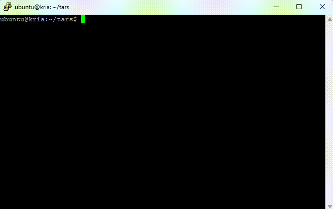

# openTARS

<p align="center"></p>

An open-source single-core NPU (TARS) that runs **Qwen3.5-0.8B, Qwen3-0.6B and Gemma 3 1B bit-exact on
a Xilinx Kria KV260**: every logit on the board matches the golden model bit for bit. Qwen3-0.6B decodes
at **0.07 s/token**, Gemma 3 1B at **0.09 s/token** and Qwen3.5-0.8B at **0.13 s/token** on short
contexts (100 MHz core clock, bitstream v3.3; 2.6 s/token at v1.0), using 90% of the XCK26's LUTs.
Qwen3.5-0.8B also has optional speculative decoding with its MTP head (same tokens, bit for bit; see below).

**Demo:** Qwen3.5-0.8B chatting on the KV260 (above; full video: [demo/Qwen3.5-0.8B-Demo.mp4](demo/Qwen3.5-0.8B-Demo.mp4)).

## Tested models

All three run on the same bitstream; only the exported model data differs. Measured on the
board, 100 MHz core clock, greedy decoding, every step's logits bit-exact against the golden model
(`run.sh <model> selftest`).

| Model | Layers | Model image on the device (INT8 W8A8 weights + states) | Decode | Prefill (20-token prompt, chunks of 4) | Example chat (31 positions) |
|---|---|---|---|---|---|
| [Qwen3.5-0.8B](https://huggingface.co/Qwen/Qwen3.5-0.8B) | 24: 18 Gated DeltaNet + 6 gated full attention | 887 MiB | 13.2 M cycles = **0.13 s/token** | 1.78 s = 0.089 s/token | 3.7 s |
| [Qwen3-0.6B](https://huggingface.co/Qwen/Qwen3-0.6B) | 28 full attention (GQA 16/8, QK-norm) | 662 MiB | 6.7 M cycles = **0.07 s/token** | 0.58 s = 0.029 s/token | 1.6 s |
| [Gemma 3 1B](https://huggingface.co/google/gemma-3-1b-it) (it) | 26 attention (GQA 4/1, head 256, QK-norm; local / global RoPE 5:1), GeGLU | 1008 MiB | 9.4 M cycles = **0.09 s/token** | 0.68 s for 17 tokens = 0.040 s/token | 2.0 s (28 positions) |

Decode slows as the context grows, because attention reads every earlier key and value. Measured on
the board (`sw/ctx_bench.py`), in M cycles per token (1 M = 10 ms):

| Position | 16 | 64 | 128 | 192 | 250 |
|---|---|---|---|---|---|
| Qwen3-0.6B (28 attention layers) | 6.71 | 7.31 | 8.12 | 8.91 | 9.51 |
| Qwen3.5-0.8B (6 attention layers) | 13.16 | 13.25 | 13.37 | 13.48 | 13.57 |
| Gemma 3 1B (26 attention layers, one KV head) | 9.39 | 9.59 | 9.84 | 10.10 | 10.34 |

Qwen3.5's prefill is slower per token because its DeltaNet recurrence
runs token by token; Qwen3's attention takes a chunk at once.
Export a model with `tools/export_kv260.py --ckpt <checkpoint> --out deploy/kv260/data_<name>` (the
checkpoint's `model_type` picks the lowering). On the board, the first argument of `run.sh` picks the
model: `sudo ./run.sh [qwen3.5|qwen3.5-mtp|qwen3|gemma3] [chat|selftest|quick|profile|...]`
(default: Qwen3.5-0.8B, chat).

## Gemma 3 1B

Gemma 3 1B needed no RTL change, only the lowering, the export and the board runtime
([details, in Chinese](docs/gemma3_1b/README.md)):

- Its sliding window (512) is longer than the context (256), so every layer runs as full attention, with
  the local or global RoPE table (base 1e4 / 1e6) of its layer type.
- Four (1 + w) RMSNorms per layer, GeGLU (tanh GELU), and the attention scale 1/16 folded into q_norm.
- `down_proj` has K = 6912, beyond the GEMV unit's 4096: it is quantized as one matrix and stored as
  two K blocks sharing the per-channel scales; the partial sums add in fp32.
- The host scales the bf16 embedding row by fp32(sqrt(1152)); the manifest carries the BOS token (once,
  at position 0), the `<end_of_turn>` turn separator and the end tokens. The runtime's multi-turn token
  sequence equals the official chat template.
- T = 256 fits the 1 GB address space with 16 MiB to spare.

W8A8 against the FP32 model (teacher-forced): top-1 agreement 84-89%, perplexity +3-5% (English
17.69 to 18.53, Chinese 46.42 to 48.91). `sudo ./run.sh gemma3` starts a chat at about 10 tokens/s.

## Version history

Hardware iterations, including simulation-only attempts marked below. Board measurements use a
100 MHz core clock and greedy decoding; selftest logits match each export's golden model bit for bit.
v1.0 to v3.2 were built between 2026-10-31 and 11-03. Decode is
Qwen3.5-0.8B on a short context unless noted. The full
story, with the problems met at each step, is in the [project log](docs/tars_kv260_history.html)
(Chinese).

| Version | Date | Main change | Decode / token | LUT |
|---|---|---|---|---|
| v1.0 | | first FPGA build: shared SFU, LUTRAM buffers, single-beat 16 B AXI bridge | 2.6 s (261 M cycles) | 85.8% |
| v1.1 | | read bursts; reads wait only for overlapping writes; performance counters | 0.90 s | 86.1% |
| v1.2 | | longer bursts and more reads in flight only (simulation, dropped) | - | - |
| v1.3 | | 4-way interleaved burst collection + reorder buffer, 128 reads in flight, batched GEMV | 0.73 s | 87.5% |
| v1.4 | | write bursts with byte merging | 0.60 s | - |
| v2.0 | | 32 B read port, HP0 at 200 MHz, GEMV 32 B / cycle, PEs on DSPs | 0.36 s | 89.4% |
| v3.0 | | 64 B read port over HP0 + HP3 at 250 MHz, GEMV 64 B / cycle, 4 rows at a time | 0.21 s | 90.8% |
| v3.1 | | systolic array removed (simulation, merged into v3.2) | - | - |
| v3.2 | 2026-11-03 | no array; 128 B read port over four HP ports; GEMV 128 B / cycle | 0.16 s (15.7 M) | 86.0% |
| v3.2b | 2026-11-07 | FDOT passes overlap, Q kept on chip (VERSION register unchanged) | 1.05-1.10x faster; Qwen3-0.6B 1.40x at position 250 | 85.65% |
| **v3.3** (current) | 2026-11-07 | FDOT at 16 products a cycle (4 lane banks, 128 B reads) | **0.13 s** (13.2 M); Qwen3-0.6B 0.07 s; Gemma 3 1B 0.09 s | 89.55% |
| v3.3 + counters | 2026-11-08 | per-operator cycle counters (`PROFILE_CAP`), sampled logits identical (experimental) | first run 0.005-0.103% slower; one repeat 0.60% slower | 89.62% |
| v3.4 | 2026-11-08 | optional packed FP16 DeltaNet state (experimental, not installed) | FP16 export 3% slower than FP32 on v3.4 | 90.50% |

Model and software milestones on these bitstreams:

| Date | Change |
|---|---|
| 2026-11-03 | Qwen3-0.6B: lowering, export and board runtime, no RTL change |
| 2026-11-06 | Qwen3.5-0.8B: optional MTP speculative decoding (bit-identical; 0.97x on average, so off by default) |
| 2026-11-08 | Gemma 3 1B (gemma-3-1b-it): lowering, export, BOS and chat template in the runtime, no RTL change |
| 2026-11-08 | `run.sh` takes the model as its first argument; operator profiler (`run.sh profile`) |

Experimental firmware and results are archived under `~/tars/firmware_v33_profile/`,
`~/tars/firmware_v34/` and `~/tars/results/`; the linked reports use this consolidated layout.

## Speculative decoding (MTP)

Qwen3.5-0.8B's checkpoint has a multi-token prediction head (one gated attention layer, 20 M
parameters), which runs on the NPU as a draft model. Each round verifies [current token, draft] in one
two-row chunk: a hit gives two tokens, a miss one. DeltaNet states are not snapshotted: the verify's
last token writes a second state copy, and a hit flips which copy is live, so a miss costs no copying.
Greedy output is unchanged: logits are bit-identical to plain decoding, checked on the board by
`run.sh selftest --data data_mtp`, and multi-turn chats match plain mode. No RTL change was needed.

**It is off by default, because on this hardware it does not pay on average.** A round costs about
1.76 plain steps: attention and the DeltaNet recurrence scale with the rows verified, and the draft
reads the 254 MB head as well. It breaks even at about 77% draft hits.

| Prompt type (`run.sh bench`, up to 96 tokens) | Draft hits | Plain | MTP | Speedup |
|---|---|---|---|---|
| JSON list | 100% | 132.6 ms/token | 116.9 ms/token | 1.13x |
| Open question | 83% | 132.4 | 126.3 | 1.05x |
| Code edit | 85% | 133.1 | 128.1 | 1.04x |
| Rewrite | 75% | 133.4 | 135.7 | 0.98x |
| Advice | 68% | 132.4 | 138.5 | 0.96x |
| Translate | 66% | 133.3 | 143.9 | 0.93x |
| Summarize | 65% | 132.8 | 143.8 | 0.92x |
| Chinese chat | 58% | 132.3 | 145.4 | 0.91x |
| Story | 55% | 132.5 | 150.6 | 0.88x |
| **Mean** | | | | **0.97x** (wall clock 0.95x) |

To try it: `python tools/export_kv260.py --mtp --out deploy/kv260/data_mtp`, then on the board
`sudo ./run.sh qwen3.5-mtp chat --spec` (`sudo ./run.sh qwen3.5-mtp bench` for the table above).

## Experiments: FP16 DeltaNet state and operator profiling

- **FP16 DeltaNet state (bitstream v3.4, off by default).** `export_kv260.py --state-dtype fp16` stores
  Qwen3.5's recurrent state as packed FP16, with all arithmetic still in FP32. On the board it was
  bit-exact against its golden model but about 3% slower to decode, and about 10% of positions changed
  their top-1 token, so the default stays FP32 and the shipped firmware stays v3.3
  ([report](docs/fp16_state_v34/README.md)).
- **Operator profiling.** `sudo ./run.sh profile --out p.json` reports read / write traffic and wait
  counters per run; a bitstream built with `PROFILE_CAP` also splits the cycles by operator (GEMV, ELT,
  FDOT, RoPE, norm, softmax, ...). Decode is read-bandwidth-bound: Gemma 3 1B reads at about 11 GB/s
  ([method](docs/kv260_profiling.md), [v3.3 results](docs/profiling_v33/README.md)).

## Layout

| Path | What |
|---|---|
| `tars_mini/` | the contract (`contract.py`), its executable golden model (`golden.py`), compiler and the Qwen3.5 / Qwen3 / Gemma 3 lowering (`llm.py`) |
| `rtl/` | the core (SystemVerilog; FPGA changes under `` `ifdef TM_FPGA ``) and the KV260 top (`tm_kv260.sv`: AXI-Lite, 4-port 128 B read bridge, page table) |
| `tests/`, `sim/` | RTL vs golden regressions (Verilator), random queue fuzz, board-like memory model |
| `fpga/kv260/` | Vivado block design and build (`build.tcl`), device-tree overlay, packaging |
| `deploy/kv260/` | board software (Kria Ubuntu 22.04): `run.sh` (model as its first argument), `setup.sh`, chat, selftest and profiler (README in Chinese) |
| `tools/export_kv260.py` | builds the board's model image from the Hugging Face checkpoint (not in git: ~1.5 GB) |
| `docs/tars_kv260_history.html` | the project log: ASIC start, FPGA port, every version, lessons (Chinese) |
| `docs/gemma3_1b/`, `docs/fp16_state_v34/`, `docs/profiling_v33/` | reports with the board logs (Chinese) |

Quick start on the board: export the model data on a PC (`python tools/export_kv260.py --ckpt <Qwen3.5-0.8B>`),
copy `deploy/kv260/` to the KV260, then `sudo ./setup.sh && sudo ./run.sh`. Other models' exports go
next to `data/` (`data_qwen3/`, `data_gemma3/`, ...) and are chosen with `sudo ./run.sh <model>`.

License: [Apache-2.0](LICENSE).

The original project notes follow.

---

## TARS-mini

The first end-to-end slice of the TARS NPU: one core, INT8 GEMM and ReLU, 512-bit descriptors
in the V1.3.1 format (VERSION 0x02), bit-exact from descriptor to DDR result, in Python (golden
model) and in SystemVerilog (RTL).

The contract ("TARS-mini 契约 v0.2") is the source of truth. `tars_mini/golden.py` is its
executable form; the RTL must match it bit for bit on every DDR byte and the end status.

## Status: v0.4 done (Qwen3.5-0.8B whole model, 24 layers + head, on one core: RTL == golden; contract v0.4; 1 GHz pre-layout)

| Phase | State | Exit criterion |
|---|---|---|
| P0 contract | done (v0.2) | layout covers 512 bits once; worked example generated and self-checked |
| P1 golden + compiler | done | a trained MLP on the golden model matches float64 within quantization error |
| P2 RTL | **done** | RTL == golden bit for bit: 5 array shapes, random queues, random stalls; every invariant tested |
| P3 performance | done | cycle counts vs roofline, where the cycles go (`docs/p3_perf.md`) |
| A3 chunk streaming | **done** | reads in flight + chunk buffers + continuous feed; bit-exact, 1.6-11.3x (`docs/a3_perf.md`) |
| B parallel epilogue | **done** | row-parallel epilogue, scale/bias once per column block, writer overlaps the next tile; 1.1-10.9x over A3 (`docs/b_reuse_perf.md`) |
| On-chip reuse | **done** | hold buffer (16 KB) keeps A or W rows across the inner tile loop, loop order per descriptor; 16x16 1.5-1.75x |
| P5 operators (v0.3) | **done** | Conv / Conv+act (implicit GEMM), Softmax / LayerNorm / RMSNorm, GELU / SiLU; bit-exact (`docs/p5_ops.md`) |
| P6 overlap | **done** | row ops VG beats/cycle + overlapped rows (97-98 % of roofline); double-buffered accumulators, epilogue beside the next tile (`docs/p6_overlap.md`); D7 = multi-pass |
| P7 prefetch | **done** | cross-tile loader prefetch: read latency hidden; GEMM 16x16 87 %, 8x8 95 %, conv 92-96 % (`docs/p7_prefetch.md`) |
| P8 DRAM + 1 GHz | **done** | LPDDR4X-4266 x32 (DRAMsim3) behind the ports; fp32 units pipelined (fadd / fmul 3 stages, exp 51, GELU 122 cycles) and every core path within 650 ps of ASAP7 logic; under DRAM the pipeline costs -1 to +2.4 %; 101/101 mutants (`docs/p8_dram_1ghz.md`) |
| v0.4 LLM blocks | **done** | contract v0.4 (ELT, ROPE, FDOT, L2NORM / QUANT, causal softmax, W8A8 ROWCOL GEMM, sigmoid / softplus / exp); extension unit tm_xpu; Qwen3.5 LA + FA blocks (small config, and one 0.8B decode token on LPDDR4X) RTL == golden byte for byte; every core path <= 650 ps (worst 604); 39/39 new or rewritten mutants caught (`docs/v04_contract.md`) |
| v0.4 GEMV + whole model | **done** | M = 1 GEMMs on the extension unit at the port's 16 B/cycle (LA 1.75x, FA 2.13x); all 24 layers + final norm + tied head (vocab 248320) in one 1 GiB image, greedy decoding with the host doing embedding and argmax; one decode step (2,730 descriptors) on the RTL byte for byte the golden model's, 57.3 M cycles with an ideal port, 76.5 M under LPDDR4X (76 ms a token at 1 GHz); every core path <= 650 ps (worst 644); 9/9 GEMV mutants caught (`docs/v04_contract.md` sections 6-7) |
| Next (to decide) | - | real checkpoint weights (accuracy); weights below 8 bits or a wider port (decode is weight-bandwidth-bound); the recurrence state on chip; SRAM macros; timing at full size with a commercial flow |

### P2 result

| Check | Result |
|---|---|
| fp32 units vs `numerics.py` | 8 vector sets, ~0.6 M vectors (random bits, subnormal boundary, ties, inf/NaN), all bit-exact |
| random queues, RTL vs golden (full DDR + status) | 60 queues x 5 array shapes (8x8, 16x16, 4x8, 8x4, 3x5), stalls 0/30/70 %, read latency 1-6; 6 long queues at 85 % stalls |
| fuzz coverage (asserted) | >= 4 error codes, canonical-NaN outputs, >= 30 cross-descriptor read-after-write hazards |
| every error code, its priority, exact-fit and one-beat-over DDR bounds | bit-exact on RTL |
| compiled programs (fused / unfused, M- and N-split, strided outputs) | 3 array shapes, bit-exact |
| the P1 MLP (2 GEMMs, 360 images) | 8x8, 16x16 + N-split, 8x4 unfused + M-split: whole 4 MB DDR identical; RTL accuracy = golden accuracy (97.5 %) |
| worst-case accumulator (K = 65520, all -128) | exact in INT32 |
| mutation check (`tools/mutate_rtl.py`) | 11 / 11 injected RTL bugs caught |

Performance baseline (MLP, no stalls, read latency 2): 8x8 array 633,610 cycles (9.1 % of the
array's peak MACs), 16x16 403,000 cycles (3.6 %). The P2 core keeps one read in flight and runs
the epilogue one element per cycle; that is where P3 starts.

## Contract v0.2 (changes from v0.1)

- **Row strides.** LDA16 (bits 111:96) and LDY16 (30:16), in 16-byte units, 0 = dense. The compiler
  can now split a GEMM along N and write column slices of one buffer (concatenation).
- **Canonical NaN.** Every NaN a multiply or add produces is 0x7FC00000 (v0.1 left it open; numpy
  on x86 gives 0xFFC00000 for inf x 0, and FP32 outputs store it as is).

## Layout

```
tars_mini/      contract, numerics, golden model, compiler, disasm, rtlsim (Verilator harness), llm.py (Qwen3.5 lowering), qwen_ref.py (transformers reference)
rtl/            tm_fp_pkg.sv (fp32 steps), tm_fpu.sv (pipelined units), tm_pe.sv, tm_array.sv (R x C systolic), tm_vpu.sv (row-engine lanes),
                tm_xpu.sv + tm_vdly.sv (v0.4 extension unit), tm_core.sv
sim/            tb_core.sv (DDR model with random backpressure and latency), tb_fp.sv, dram/ (LPDDR4X via DRAMsim3, DPI)
examples/       mlp_digits.py (trained MLP -> TARS-mini)
tests/          748 tests: contract, numerics, golden, compiler, MLP, v0.4 ops + Qwen blocks (golden vs transformers), RTL fp units, RTL core, RTL v0.4
tools/          mutate_rtl.py (inject bugs into the RTL; every one must be caught), perf_report.py, perf_p5.py,
                perf_dram.py, fetch_dramsim3.sh, timing/ (ASAP7 flows: units, stages, whole core; sta.py)
tars_mini_ref.py  the P0 reference script (v0.1), kept as is
```

## Run

```sh
pip install numpy scikit-learn pytest      # and Verilator >= 5 for the RTL tests
python3 -m pytest -q                       # 748 tests, ~9 h on 2 cores from scratch (each array configuration is a ~10 min Verilator build; cached after)
python3 examples/mlp_digits.py             # P1 report
python3 tools/mutate_rtl.py                # mutation check (141 mutants; a fast tier, then each one's own test subset), ~1 day on 2 cores; --only 'a|b' reruns some
sh tools/fetch_dramsim3.sh && python3 tools/perf_dram.py   # cycles on LPDDR4X-4266 vs the ideal port
python3 tools/perf_qwen.py                 # Qwen3.5-0.8B: one decode token (LA, FA, norm, a head block) on the RTL under LPDDR4X, checked vs golden
python3 tools/run_qwen_full.py golden|ref|rtl [--dram]   # the whole 0.8B model: greedy decoding on golden, vs transformers, one step on the RTL (~4 h)
sh tools/timing/run_core_h.sh <asap7.lib> <sv2v>           # every core path vs the 650 ps budget (Yosys, ABC, sta.py)
python3 tools/perf_report.py --baseline docs/p3_perf.json   # cycles vs roofline and vs P2
```

## Lessons from P2

- Random vectors almost never hit a rounding tie (about 1 in 2^23 for a product). A "round half up"
  multiplier passed 200 k random vectors; constructed tie vectors caught it at once.
- A coverage assertion on the fuzz (error codes hit, NaN outputs, cross-descriptor hazards) found
  that the first generator produced no NaN at all and almost no hazards.
- Two of the first mutants were equivalent (no behaviour change), and one directed test missed
  its target because the read cache holds a single 16-byte beat. Hazard tests have to be built on
  the microarchitecture's actual state.
- The array drain is not needed in this core (the element-serial epilogue is slower than the
  array's last products); it stays for when the epilogue becomes parallel.

## Lessons from A3

- A systolic array cannot be stalled at its edges alone: a and w meet in PE (i, j) only if every
  edge is delayed by the same amount at the same virtual step. The stall has to freeze the whole
  array (one enable per PE register).
- The old fuzz (K <= 64, 4 chunks) never wrapped the 4 chunk buffers, so slot-reuse bugs were
  invisible to it. The new tests shrink NB and OT and lengthen K until every slot and every
  credit is reused; the reuse mutants were caught only by those tests.
- The projection was right where its assumptions held (decode within 2-7 %) and optimistic where
  it had folded in an unbuilt part (epilogue read latency). Write down what each projection
  assumes, so a shortfall points at the missing piece.

## Lessons from B and reuse

- Removing a stage needs a timing argument, not a test run: the drain was unnecessary once rows
  are read in order (row i is final at step K+i+C-1), and the argument says exactly when that
  would stop being true (an epilogue that reads rows out of order or faster than one per step).
- A mutant that used to be caught can become equivalent after a refactor: once GEMM had its own
  writer, the RELU packer only ever wrote whole beats, so its strobes no longer mattered.
- Projections undercount changes that remove work (the drain) and overlap phases (the writer under
  the next tile): B was projected at 1.06-6.4x and measured 1.1-10.9x.
- Reuse needs a coverage assertion of its own: fuzz shapes decide the loop order and whether K
  fits, so the test asserts that held tiles occur in both orders and that too-large GEMMs occur.

## Lessons from P5

- Write the transcendental functions as fixed fmul/fadd sequences in the golden model first, and
  measure them: two first drafts failed (recip(1) = 0.99999994 broke GELU's tail by 13 orders of
  magnitude; rsqrt underflowed to NaN near 2^-126). Normalizing the mantissa before Newton steps,
  and correction-form steps, fixed both before any RTL existed.
- A coverage assertion can fail because the generator changed, not because the design did. Measure
  coverage on the programs the fuzz actually runs, and add a configuration that produces the
  missing case (a 3x16 array for m-inner reuse) instead of lowering the threshold.
- The fuzz caught an edit whose `//` comment swallowed two latches on the same line. Whole-program
  random queues find what targeted tests and mutants were not looking for.
- A roofline must model the machine's channels: the DDR model and AXI read and write in parallel,
  and a one-port model showed an activation running at 145 % of its "roofline".
- Mutation runs need per-mutant test subsets and build cleanup once the core is large: 48 mutants
  times a dozen builds filled the session's disk once.
- The mutants found five test holes the fuzz could not: random-byte data makes sums insensitive to
  the reduction order the contract fixes, error tests can be rejected by an earlier rule than the
  one they target, and some behaviour shows only on the last descriptor under write backpressure or
  on all-negative rows. Directed tests on well-conditioned data closed all five.
- Splitting one signal into a feed copy and a loader copy (for prefetch) silently weakened two
  mutants that used to break both: each now breaks only one side, and one side's damage is a race
  or extra traffic. A rerun of the full mutation set after a structural change is what found it;
  the fixes were a directed race test and a traffic bound.

## Lessons from P8

- A DRAM model changes what is worth optimizing: the loader's row interleave was harmless on the
  ideal port and cost 2.7x read amplification on LPDDR (one 64 B burst per 16 B used); four
  consecutive chunks per row visit fixed it. Little's law sized the reads in flight (100 ns x
  17 GB/s ~ 1.7 KB, so 128 beats, not 32).
- ABC's area recovery makes every path that is not the worst look as slow as the worst: ~100
  "violations" in the first core report were artifacts (i2f 893 ps in the core, 601 ps alone).
  Map without area recovery and time every endpoint (tools/timing/sta.py) before redesigning.
- The fixes that closed timing were mostly bookkeeping, not arithmetic: counters kept beside the
  indices they replace compares of (left-to-issue, rows-in-tile, the queue address), flags
  registered one step ahead (the feed window), a candidate register between choosing a read and
  issuing it, and the descriptor check's products in a sequencer hidden under the CRC.
- A non-stalling pipeline needs its output buffer sized for the lane latency: 64 slots for a
  122-cycle GELU lane halved the activation's throughput; the DRAM run showed it as a 17 %
  regression that the ideal-port numbers alone would have blamed on the memory.
- 1 GHz costs the row operators 1.3-1.45x on an ideal port (a 3-cycle fadd makes the contract's
  ordered 16-lane sum one step per 3 cycles, and each pass ends with a ~100-cycle fold and
  scalar) and at most 2 % on LPDDR4X, which the memory hides.
- Pipelines make equivalent mutants: a delay line off by a few cycles changes nothing when the
  value it carries is constant over the gap (a tile's bias, a row's 1/sum). Five such mutants were
  rewritten to break what the pipeline must keep apart (columns, slots) instead; one mutant that
  survived honestly found the lane spacing a cycle slower than needed, a free 3-6 % on row ops.
- A mutation run on 2 cores needs triage: a fast tier (one 8x8 fuzz build) before each mutant's
  full subset, a cycle cap so a mutant that hangs the core fails in seconds, and ccache.

## Lessons from v0.4 (Qwen3.5 LA + FA blocks)

- Decide the numerics against the real reference before any RTL: the golden model's lowering
  was checked against transformers with the same W8A8 linears (block updates within 1.2e-6) before
  a line of tm_xpu existed, so every later RTL difference was an RTL bug, not a modelling question.
  The first softplus (log of 1 + e) was 17 % off near 0; ln(1 + t) as 2 atanh(t / (t + 2)) fixed it.
- A tagged read stream keeps a new unit small: the reader tags each beat with its operand and, on
  a step's last beat, the step's meaning; the consumer only collects and fires, with no second
  walker to keep in step with the first.
- Fields that default to 0 bite: a register that only the causal-softmax path set (the valid
  length) left the overlapped norm path masking every element (all outputs inf) until it got a
  dispatch default. And three tests failed for the right reason: they asserted that v0.3 codes
  were illegal (ROW CTRL 3, activations 5 and 7 in a test bench that dropped act early).
- Simulation and synthesis cost grew faster than the logic: per-lane 256-entry delay lines and
  128-deep tag FIFOs made each Verilator build ~10 min and Yosys run out of memory beside a build;
  the delay lines are now a separate two-port memory (an SRAM in a real design, a black box in the
  timing flow).
- The end-to-end number is GEMV-bound: one 0.8B decode token is ~7.9 M cycles at 8x8, mostly the
  M = 1 linears on one array row. That, not the new operators, is what to fix next for decode.
- A GEMV is not a GEMM with M = 1: an output-stationary array then uses one row and streams the
  weights at C bytes a cycle. A dedicated dot-product path at the port's 16 bytes a cycle needed no
  contract change (the INT32 sum is exact in any order) and made decode port-bound (99 % of cycles
  are read beats with an ideal port).
- Full-model runs are a memory problem before a time problem: a 1 GiB image held three times by
  the harness (input, output, expected) plus a Verilator build exceeds 6.5 GB. The harness now
  streams the image from a file and the comparison is chunked; builds and long simulations run apart.
- Field widths shape the memory map: a 24-bit row-scale offset (HDR_RSV) puts state and scratch
  below the 1 GiB of weights, a 16-bit N splits the 248320-row head into four GEMVs.
- Mutation found the one real RTL bug the tests had missed: the extension unit reserved its
  output-queue slack by subtracting 3 from the queue size, which wraps for queues under 4 slots
  and was only ever tested at 128. Counting the launch already under way is exact at any size.
